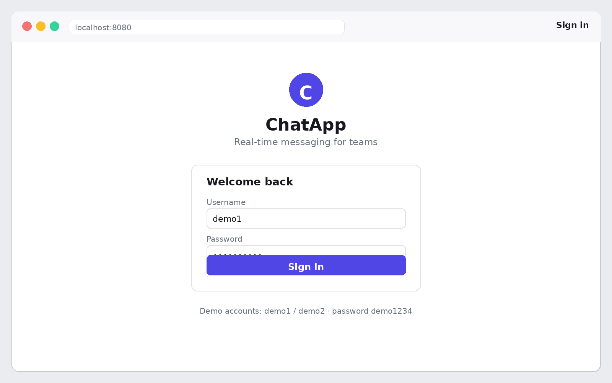
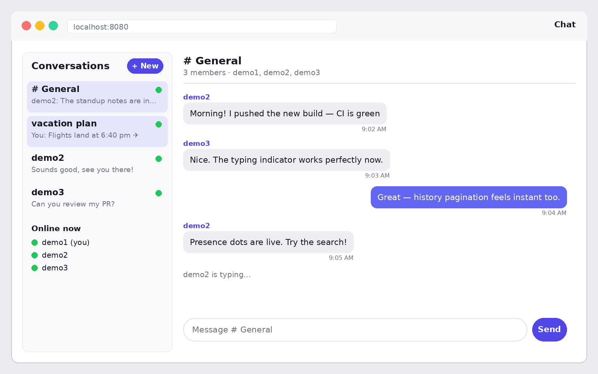
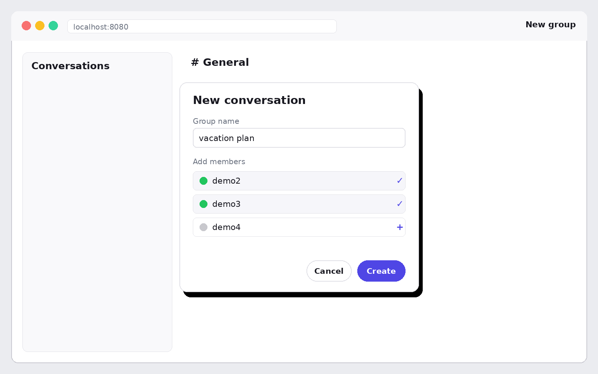

# Real-Time Chat Application

A full-stack real-time messaging app: **ASP.NET Core + SignalR** backend with **SQL Server**,
and a **React + TypeScript** frontend. Built as a portfolio project — the whole thing runs with
one command via Docker Compose.

## Demo







*UI previews rendered from the app's actual screens — sign in, the chat window with presence and typing indicators, and creating a group. Run it locally with Docker to see the real thing.*

## Architecture

```
┌────────────────────┐        ┌────────────────────┐        ┌────────────────────┐
│  React SPA (nginx) │        │  ASP.NET Core API  │        │  SQL Server        │
│                    │        │                    │        │  (azure-sql-edge)  │
│  • AuthContext     │ REST   │  • AuthController  │  EF    │  • Users           │
│  • ChatPage        ├───────►│  • Conversations   ├───────►│  • Conversations   │
│  • MessagePane     │ /api   │  • Messages        │ Core   │  • Conversation-   │
│  • Sidebar         │        │  • Presence        │        │    Members         │
│                    │ WS     │                    │        │  • Messages        │
│  • SignalR client  ├───────►│  • ChatHub /hubs/  │        │    IX (Conver-     │
│    auto-reconnect  │        │    Groups per      │        │    sationId,SentAt)│
│    optimistic UI   │        │    conversation    │        │                    │
└────────────────────┘        └────────────────────┘        └────────────────────┘
```

**Real-time flow:** the browser opens one SignalR connection (`/hubs/chat`, JWT via
`?access_token=`). Joining a conversation subscribes that connection to a SignalR **group**
named after the conversation id. `SendMessage` persists the row, then broadcasts only to that
group. Typing indicators go to `OthersInGroup`; presence (`UserOnline`/`UserOffline`) is
broadcast to all clients.

## Run it

### Option A — Docker (recommended, everything included)

```bash
cd chat-app
docker compose up --build
```

- App: http://localhost:8080
- API: http://localhost:5000 (Swagger at `/swagger` only in Development)
- SQL Server: localhost:1433 (user `sa`, password `ChatApp123!` unless `MSSQL_SA_PASSWORD` is set)

Demo login (seeded automatically): **demo1 / demo2**, password `demo1234`, with a
pre-filled `#General` channel. To change the JWT signing key, set `JWT_KEY` (min 32 chars).

### Option B — Local development

1. Start SQL Server in Docker:
   ```bash
   docker run -e ACCEPT_EULA=Y -e MSSQL_SA_PASSWORD=ChatApp123! -p 1433:1433 \
     mcr.microsoft.com/azure-sql-edge
   ```
2. Backend:
   ```bash
   cd backend/src/ChatApp.Api
   dotnet run
   # API on http://localhost:5000, Swagger on http://localhost:5000/swagger
   ```
   The connection string in `appsettings.Development.json` points at `localhost,1433`.
3. Frontend:
   ```bash
   cd frontend
   npm install
   npm run dev
   # App on http://localhost:5173 (proxies /api + /hubs to the API)
   ```

### Run the tests

```bash
dotnet test backend/tests/ChatApp.Tests/ChatApp.Tests.csproj
```

## API reference

All `/api/*` routes except `POST /api/auth/*` require `Authorization: Bearer <JWT>`.

| Method | Route | Description |
|---|---|---|
| POST | `/api/auth/register` | `{username, email, password, displayName}` → `201` + user (BCrypt-hashed) |
| POST | `/api/auth/login` | `{usernameOrEmail, password}` → `200 {token, user}`, `401` on bad creds |
| GET | `/api/auth/me` | Current user from the JWT |
| GET | `/api/conversations` | My conversations: member count, member list, last-message preview |
| POST | `/api/conversations` | `{name?, isGroup, memberUsernames[]}` → `201`; creator auto-added |
| POST | `/api/conversations/{id}/members` | Add users by username (requester must be a member) |
| GET | `/api/messages?conversationId=&before=&limit=` | Cursor-paginated history, oldest→newest + `hasMore` |
| POST | `/api/messages` | `{conversationId, content}` → `201` (used as the send fallback) |
| GET | `/api/messages/search?conversationId=&q=` | `LIKE`-based content search, newest first, top 50 |
| GET | `/api/presence/online` | Ids of currently-online users |

### SignalR hub (`/hubs/chat`, authorized)

Client → server:

| Method | Args | Description |
|---|---|---|
| `JoinConversation` | `conversationId` | Subscribe to a conversation's group (membership verified) |
| `LeaveConversation` | `conversationId` | Unsubscribe |
| `SendMessage` | `conversationId, content` | Persist + broadcast to the group |
| `TypingStart` / `TypingStop` | `conversationId` | Typing indicator to other members |

Server → client:

| Event | Payload | Description |
|---|---|---|
| `ReceiveMessage` | `MessageDto` | A new message in a joined conversation |
| `UserTyping` | `{userId, username, conversationId, isTyping}` | Typing indicator |
| `UserOnline` / `UserOffline` | `{userId, username}` | Presence changes |

## Database schema

Normalized, EF Core Fluent API (`ChatDbContext`):

- **Users** — `Id (PK)`, `Username` (unique), `Email` (unique), `PasswordHash`, `DisplayName`
- **Conversations** — `Id (PK)`, `Name?`, `IsGroup`, `CreatedById → Users` (restrict)
- **ConversationMembers** — composite PK `(ConversationId, UserId)`, index on `UserId`
- **Messages** — `Id (PK, identity)`, `ConversationId → Conversations` (cascade),
  `SenderId → Users` (restrict), `Content (nvarchar(2000))`, `SentAt`

**Indexing:** a composite index on `Messages(ConversationId, SentAt)` serves both hot paths —
paginated history (`WHERE ConversationId = @id ORDER BY SentAt DESC`) and per-conversation
search — as an index seek instead of a table scan.

**Why cursor pagination:** `GET /api/messages` takes an exclusive `before` cursor (ISO-8601
`SentAt`) and returns the next `limit` older messages plus `hasMore`. Unlike offset
pagination it stays stable when new messages arrive mid-scroll (no duplicates/skips), and
with the composite index every page is a cheap range seek. The client fetches newest-first
and reverses to chronological order for display.

## Frontend notes

- **Optimistic updates:** a sent message renders instantly as "sending". The primary path is
  the SignalR `SendMessage` invoke — the server's `ReceiveMessage` echo (matched by sender,
  deduped by id) flips it to sent. If the hub call fails, the client falls back to
  `POST /api/messages`; if that fails too the bubble shows "failed — tap to retry".
- **Automatic reconnection:** `withAutomaticReconnect()` (0s/2s/10s/30s backoff); on
  reconnect the client re-joins the open conversation, since SignalR groups are
  per-connection. A banner shows the connection state.
- **Presence & typing:** `UserOnline`/`UserOffline` drive the green dots; `UserTyping`
  shows "X is typing…" with a 3s expiry.

## Interview talking points

- **Why SignalR groups instead of broadcast:** `Clients.Group(conversationId)` fans out only
  to members of that conversation — O(members) instead of O(all users), and membership is
  re-verified server-side on every `JoinConversation`/`SendMessage`, so clients can't snoop.
- **JWT flow:** login returns a signed HMAC-SHA256 token (claims: `NameIdentifier`,
  `Name`); the API validates issuer/audience/lifetime. Browsers can't set an
  `Authorization` header on the WebSocket handshake, so the client passes
  `?access_token=` and a `JwtBearerEvents.OnMessageReceived` hook picks it up for `/hubs/*`.
- **Optimistic UI trade-offs:** instant feedback at the cost of possible rollback — failed
  sends are marked, never silently dropped, and the echo-dedupe (by server id) guarantees
  exactly-once display even though both hub and REST paths can deliver the message.
- **Scaling presence:** the in-memory `PresenceTracker` (user → connection-id set) is
  single-server. With multiple API instances you'd add the **Redis backplane**
  (`Microsoft.AspNetCore.SignalR.StackExchangeRedis`) so group messages cross servers, make
  presence a Redis hash with expirations, and use **sticky sessions** (or skip negotiation
  affinity via Azure SignalR Service) so WebSocket frames land on the server holding the
  connection.
- **What I'd add next:** read receipts, message edits/deletes, file attachments (blob
  storage + CDN), full-text search (SQL Server `CONTAINS` / OpenSearch), rate limiting,
  and refresh-token rotation.

## Project layout

```
chat-app/
├── backend/
│   ├── src/ChatApp.Api/        # Web API: controllers, ChatHub, services, EF Core
│   ├── tests/ChatApp.Tests/    # xUnit: auth, pagination, search, presence
│   └── Dockerfile
├── frontend/                   # React + Vite + TypeScript SPA
│   ├── src/                    # pages, components, SignalR + axios wiring
│   ├── Dockerfile
│   └── nginx.conf              # serves SPA; proxies /api and /hubs to the API
├── docker-compose.yml
├── .github/workflows/ci.yml    # dotnet build+test, npm build
└── README.md
```
